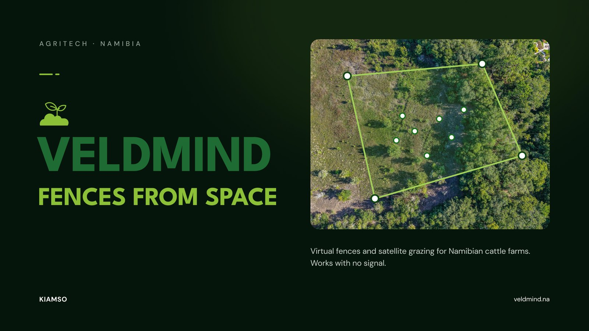
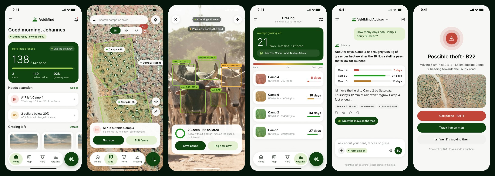
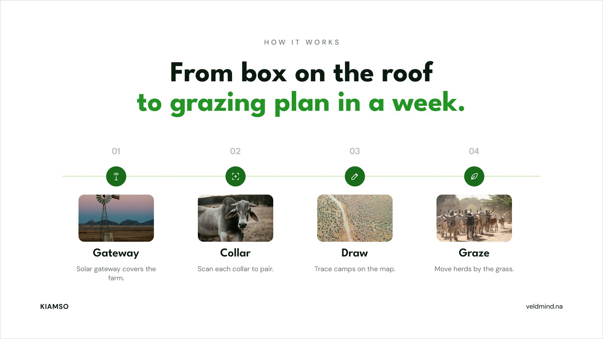

# VeldMind



**VeldMind lets Namibian cattle farmers fence their land without posts or wire.**
Farmers draw camps on a map in the app. Solar GPS collars keep the cattle inside, and satellite data shows which camp has grass ready for grazing. Everything keeps working where there is no phone signal.

Built by team **KIAMSO**.

---

## What it does

| Feature | In simple words |
|---|---|
| **Virtual fences** | Draw a camp on the map. If a cow walks out, her collar plays a sound, then vibrates. If she stays out, you get an alert. |
| **Live herd map** | See every collared cow on a satellite map, in 2D, 3D or AR. |
| **Satellite grazing** | A new grass reading for every camp every 5 days, with the days of grazing left. |
| **Herd scan** | Point the phone camera at the herd. On-device AI counts the cattle and spots any without a collar. |
| **Veld advisor** | Ask a question in plain words. The answer is based on your own farm data. |
| **Works offline** | A solar gateway on the farm runs the fences and sends SMS alerts with no internet. |



## How it works



1. **Gateway**: a small solar box on the farmhouse roof listens to the collars over LoRa radio.
2. **Collars**: each cow wears a solar GPS collar. Pair a collar by scanning its QR code.
3. **Draw**: trace your camps on the satellite map.
4. **Graze**: move herds by moving fences in the app, guided by the grass readings.

## Tech stack

| Part | Tools |
|---|---|
| Mobile app | Flutter (Dart), MapLibre maps, drift (SQLite) for offline use |
| Backend | FastAPI (Python) |
| Database & login | Supabase: Postgres + PostGIS, Auth, Realtime, Storage |
| Farm gateway | Raspberry Pi, ChirpStack (LoRaWAN), Python fence engine |
| Collars | ESP32 + GPS + LoRa |
| Satellite & weather | Sentinel 2 (Copernicus), Open-Meteo |
| AI | YOLO model running on the phone (TFLite), advisor using farm data |
| Alerts | Push notifications, SMS and USSD |

## Project folders

```
veldmind/
├─ app/        Flutter mobile app
├─ api/        FastAPI backend
├─ gateway/    Raspberry Pi gateway and fence engine
├─ firmware/   Collar firmware (ESP32)
├─ supabase/   Database migrations and security rules
├─ ml/         Herd count model training
└─ docs/       Notes, images and decisions
```

Some of these folders will be added as the build goes on.

## Getting started

1. Clone the repo:
   ```bash
   git clone https://github.com/DrGitman/VeldMind.git
   cd VeldMind
   ```
2. Copy the example settings file and fill in your own keys:
   ```bash
   cp env.example .env
   ```
   Never commit `.env`. It is already in `.gitignore`.
3. Read [CONTRIBUTING.md](CONTRIBUTING.md) before your first branch.

## How we use branches

- `main` holds the **final product** only.
- `dev` is where all work comes together.
- Every task gets its own **short-lived** branch from `dev`, for example `feature/VM-41-fence-editor`.
- Branches merge back into `dev` through a pull request.
- When the product is ready, `dev` is merged into `main`.

## Team KIAMSO

| Role | Focus |
|---|---|
| Team lead | Product, research, pitch |
| Technical lead | Architecture, gateway, database |
| Frontend developer | Flutter app |
| QA lead | Testing and field trials |
| Backend developer 1 | Satellite data and AI |
| Backend developer 2 | IoT, alerts and SMS |

## License

See [LICENSE](LICENSE). Third-party tools, data and photos are listed in [THIRD_PARTY_NOTICES.md](THIRD_PARTY_NOTICES.md).
